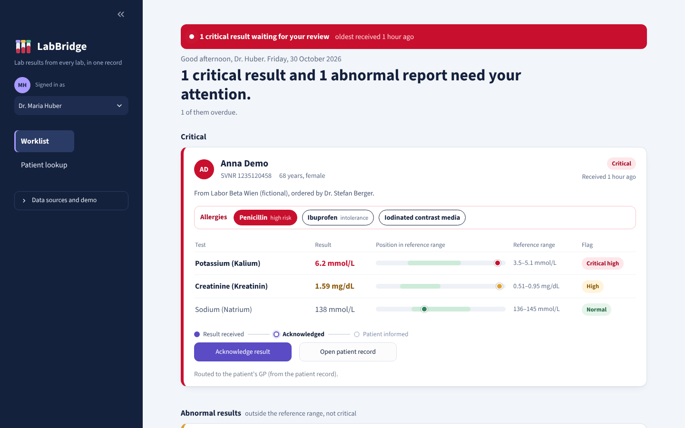
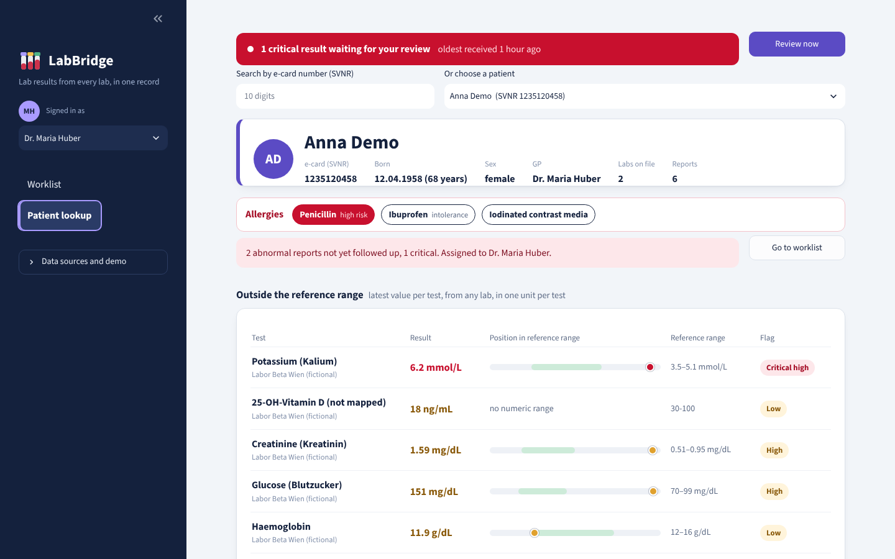
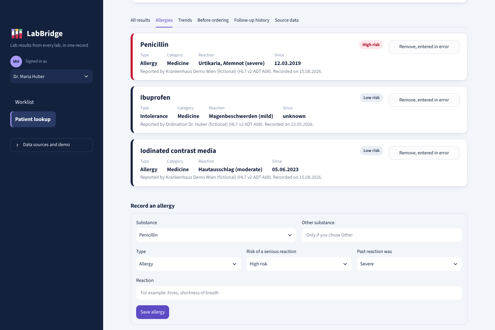
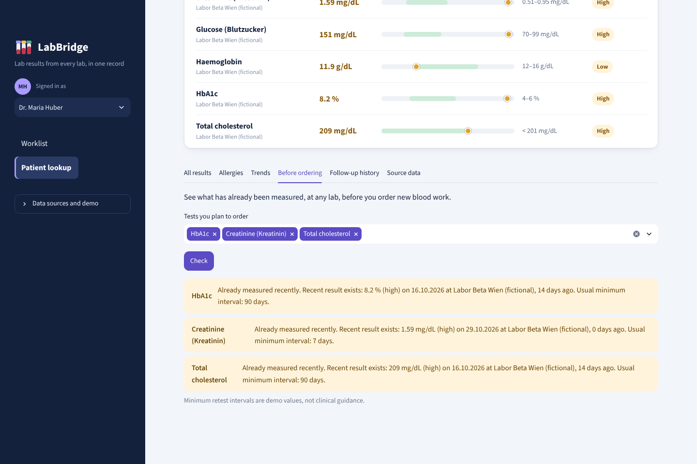
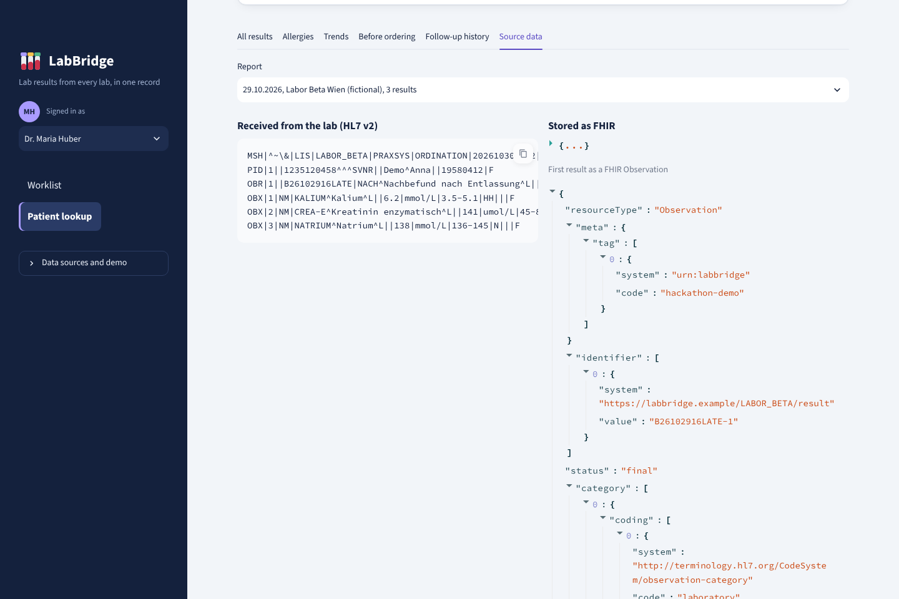
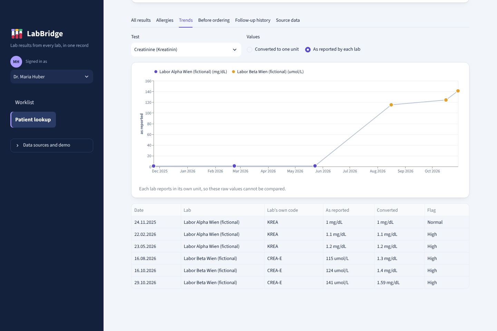
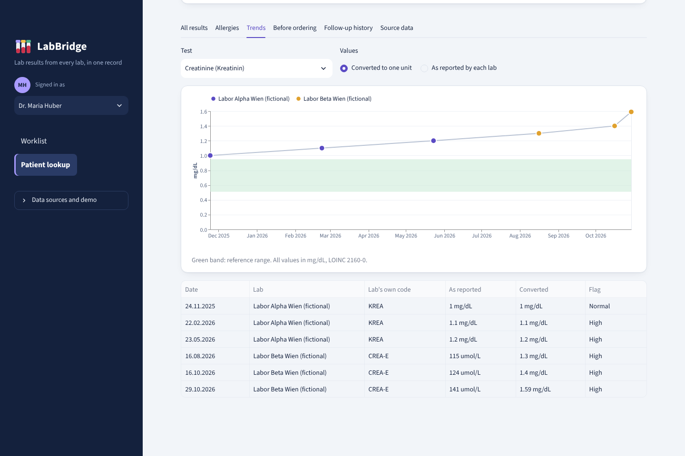

# LabBridge: design report and decision log

Track 2, Health Data Interoperability · Vienna

This report explains why LabBridge was built, how it works, and why each important choice was made.
It is written for judges, mentors and the team itself. Every decision lists the alternatives that were
considered, so the reasoning can be challenged.

---

## 1. Summary

LabBridge takes blood test results from different labs, in the format labs send today (HL7 v2), and
turns them into one standard record per patient (HL7 FHIR), found by the patient's e-card number. On
top of that record, a doctor can:

- see results from every lab **side by side**, converted to the same unit, with trends over time
- check, **before ordering**, whether a test was already done recently at another lab
- get every **abnormal result on a worklist**, even if it arrives after the patient has left hospital,
  and track it until the patient has been informed
- see the patient's **allergies** from every system that reported them, on every screen

The guiding sentence: every lab result in Vienna should be **readable** (any lab, one standard),
**visible** (one record per e-card) and **acted on** (no abnormal result goes unnoticed).

### What it looks like

All screenshots are from the working prototype, running on the fictional demo data described in
section 3.

**The doctor's worklist.** The app opens here. A critical potassium result that arrived after the
patient left hospital is at the top, routed to her GP, with her allergies on the same card. The red
bar stays on every screen until the result is acknowledged.



**The patient record.** Found by e-card number. Allergies from every system come first, then open
follow-ups, then every latest value outside its reference range, from any lab, in one unit. The dot on
each bar shows where the value sits relative to the normal range (green).



**Allergies.** Merged from the hospital and the GP's practice software, with the reaction, how long
the patient has had it, and which system reported it. Doctors can record new allergies here.



**Before ordering.** A doctor about to order HbA1c, creatinine and cholesterol sees that all three
were measured recently, at another lab.



**Source data.** What the lab actually sent (HL7 v2, left) next to what LabBridge stored (FHIR,
right), so every value can be traced back to its source.



---

## 2. Why it was created

### The problem

The track description names it: patient data is spread across systems that were never designed to work
together, so information gets **lost, duplicated, or re-entered by hand**.

Blood work is one of the clearest cases. A test passes through several systems: the doctor orders it in
practice software, a lab runs it in its own system and sends results back, and another doctor (a
specialist, a hospital) needs them later. At each handover:

- results do not reach the doctor who needs them,
- tests are ordered again because a recent result cannot be seen,
- every lab uses its **own test codes** and often **different units** (creatinine in mg/dL or µmol/L),
  so results from two labs cannot be compared or plotted together,
- results from PDF or paper get typed in again by hand.

### Evidence

| Finding | Source |
|---|---|
| Austria's Court of Audit (Oct 2024): ELGA is incomplete, which leads to unnecessary duplicate examinations; e-findings came almost only from hospitals | ORF report on the Rechnungshof review |
| Austria now requires lab and radiology results in ELGA: office-based doctors from 1 July 2025, hospitals from 1 January 2026 | Austrian Ministry of Health |
| 41% of 2,644 patients at two Boston hospitals left before all results were back; 9% of pending results were potentially actionable; doctors were unaware of 65 of them | Roy et al., Annals of Internal Medicine, 2005 |
| 7.1% of abnormal results in 23 US primary care practices were not communicated to the patient, or not documented as communicated | Casalino et al., 2009 |
| About 11.7% of orders for 17 common inpatient tests were duplicates; an electronic alert cut the odds of a duplicate by about 18% | Bejjanki et al., 2018 |
| England lost about 16,000 positive COVID-19 results in 2020 when lab data was moved between systems through spreadsheets that silently cut off rows | Public Health England, reported by The Conversation |

The US studies are older and from a different system. They show the problem is well known. The
Austrian sources show it is current and relevant in Vienna.

### Why now

- Lab results in ELGA became mandatory in 2025–2026, so lab data exchange is a current priority.
- The European Health Data Space requires standardised cross-border exchange of key data by 2029,
  and FHIR is the direction Austria and the EU are moving in.
- Most labs and practice systems still send HL7 v2 today. Bridging the old and the new standard is
  exactly the work the next years require.

---

## 3. How it works

### Overview

```
  Labor Alpha  (HL7 v2, mg/dL, own codes) ─┐
  Labor Beta   (HL7 v2, SI units, own codes)├─► 1 parse ─► 2 map codes & units ─► 3 FHIR bundle ─► 4 FHIR server
  Hospital / GP (HL7 v2, allergies)        ─┘                                                         │
                                                                                                       ▼
                                          5 doctor dashboard: worklist · patient record · trends · allergies
```

1. **Parse** (`hl7v2.py`): reads HL7 v2 messages. Lab results arrive as `ORU^R01`, patient updates
   with allergies as `ADT^A08`. Segments used: `MSH` (sender, time), `PID` (patient), `PD1` (GP),
   `OBR` (the test order, who ordered it), `OBX` (one result), `AL1` (one allergy).
2. **Map** (`lab_catalog.py`, `allergy_catalog.py`): each lab's own test code is mapped to a LOINC
   code, and the value is converted to one unit per test. Allergy codes are mapped to WHO ATC
   (medicines) or SNOMED CT (other substances).
3. **Convert** (`converter.py`): each message becomes one FHIR *transaction bundle*: Patient,
   Organization (the lab), Practitioner (GP and ordering doctor), ServiceRequest (the order),
   DiagnosticReport (the lab report, with the original message attached), one Observation per value,
   AllergyIntolerance per allergy, and a Task if a recent result is abnormal.
4. **Store** (`fhir_client.py`): the bundle is sent to a FHIR server, either a real one (the public
   HAPI test server or any URL) or an offline store on the laptop that behaves the same way.
5. **Use** (`app.py`, `ui.py`, `analysis.py`): the dashboard reads everything back **from the FHIR
   server**, not from the original files. That proves the round trip works.

### A worked example

This is one real message from the demo data, sent by the fictional Labor Beta (shortened):

```
MSH|^~\&|LIS|LABOR_BETA|PRAXSYS|ORDINATION|202610161430||ORU^R01|B-MSG-B261016123|P|2.5
PID|1||1235120458^^^SVNR||Demo^Anna||19580412|F
OBR|1||B261016123|PANEL^Laborbefund^L|||202610160730|||||||||KH101^Berger^Stefan^^^Dr.
OBX|3|NM|CREA-E^Kreatinin enzymatisch^L||124|umol/L|45-84|H|||F
```

The creatinine line (`OBX|3`) becomes this FHIR Observation (identifiers and references left out):

```json
{
  "resourceType": "Observation",
  "status": "final",
  "effectiveDateTime": "2026-10-16T07:30:00+02:00",
  "code": {
    "coding": [
      {"system": "http://loinc.org", "code": "2160-0",
       "display": "Creatinine [Mass/volume] in Serum or Plasma"},
      {"system": "https://labbridge.example/LABOR_BETA/codes", "code": "CREA-E",
       "display": "Kreatinin enzymatisch"}
    ],
    "text": "Creatinine (Kreatinin)"
  },
  "valueQuantity": {"value": 1.4, "unit": "mg/dL", "system": "http://unitsofmeasure.org", "code": "mg/dL"},
  "extension": [{"url": "https://labbridge.example/fhir/StructureDefinition/original-quantity",
                 "valueQuantity": {"value": 124.0, "unit": "umol/L"}}],
  "referenceRange": [{"text": "45-84 umol/L (as reported)",
                      "low": {"value": 0.51, "unit": "mg/dL"}, "high": {"value": 0.95, "unit": "mg/dL"}}],
  "interpretation": [{"coding": [{"code": "H", "display": "High"}]}]
}
```

What happened: the lab's own code `CREA-E` was mapped to LOINC `2160-0` (and kept next to it), 124
µmol/L was converted to 1.4 mg/dL (and the original kept), the reference range was converted too, and
the lab's "high" flag was kept. Labor Alpha sends the same test as `KREA` in mg/dL, so both now land on
the same LOINC code and unit, and can be plotted on one line.

The same message produces 15 FHIR resources: Patient, Organization, Practitioner, ServiceRequest,
DiagnosticReport, 9 Observations and 1 Task.

### The demo scenario

All data is fictional and generated by `demo_data.py`, with dates relative to today so the demo always
looks current.

- **Anna Demo** (68, diabetic) had blood work at her GP via Labor Alpha three times, then twice at a
  hospital via Labor Beta, which uses different codes and SI units. Normalised, her creatinine and
  HbA1c rise steadily; as reported, the values look like they jump from about 1 to about 120.
- Her results from two weeks ago were abnormal and nobody has followed them up: an overdue task.
- The **late result**: blood taken in hospital the night before discharge comes back with a critical
  potassium of 6.2 mmol/L after she has gone home. The hospital lab does not know her GP. LabBridge
  does, from her patient record, and puts it at the top of Dr. Huber's worklist.
- **Allergies**: the hospital reports penicillin and iodinated contrast media; her GP's software
  reports penicillin again and an ibuprofen intolerance. LabBridge stores penicillin once.
- **Max Muster** has normal results and no allergy information anywhere, which the app shows as
  "Allergies not recorded".

---

## 4. Decision log

### D1. Track: Health Data Interoperability

- **Decision:** compete in the Health Data Interoperability track.
- **Alternatives:** Clinical Documentation (likely the most crowded, mostly "an LLM on clinical
  notes"); European Health Data Space (strong topic, but heavy on regulation and governance, hard to
  demo in 24 hours).
- **Why:** it is an engineering problem (formats, APIs, mappings) that fits the team's electrical and
  computer engineering background, and it can be shown working end to end.

### D2. Focus on blood work, not wearables

- **Decision:** solve lab result exchange. The first prototype, VitalBridge (wearable vital signs
  to FHIR), was dropped.
- **Alternatives:** wearables to FHIR; merging records from two systems; an HL7 v2 to FHIR converter
  on its own.
- **Why:** blood work affects almost every patient and every judge has experienced a repeated blood
  test. It uses **both** standards named in the track (HL7 v2 in, FHIR out) and hits all three
  problems in the track description. It has current Austrian relevance (ELGA lab mandate, Court of
  Audit). Two topics in one demo would weaken the story, so the wearable idea is a future extension
  only: the same pipeline would work for device data.

### D3. Input format: HL7 v2 lab messages

- **Decision:** read HL7 v2 `ORU^R01` (lab results) and `ADT^A08` (patient updates with allergies).
- **Alternatives:** PDF lab reports; HL7 CDA documents (what ELGA stores today); CSV.
- **Why:** HL7 v2 is what labs and hospital systems actually send to practice software today, so the
  prototype starts from the real world. PDFs are made for people, not machines; reading them reliably
  needs text extraction and a human check (see Next steps). CDA input is a natural next translator.

### D4. Output format: FHIR R4

- **Decision:** convert everything to FHIR R4.
- **Alternatives:** FHIR R5; HL7 CDA; a custom JSON format.
- **Why:** R4 is the most widely supported version, the public HAPI test server offers it, and HL7
  Austria publishes its national FHIR profiles for R4. A custom format would recreate the problem the
  track asks us to solve. The output was checked against the R4B models of the `fhir.resources` Python
  library, which match R4 for the resources used.

### D5. Patient identity: the e-card number

- **Decision:** identify patients by the Austrian social insurance number (SVNR) on the e-card, using
  the identifier system defined by HL7 Austria (`urn:oid:1.2.40.0.10.1.4.3.1`). Numbers are checked
  with the SVNR checksum. All demo numbers are fake but checksum-valid.
- **Alternatives:** name and birth date matching; a LabBridge-internal ID.
- **Why:** every system in Austria already knows the SVNR, so results from any lab land on the same
  record. Name matching is error-prone (spelling, duplicates). In production, access would need the
  e-card infrastructure and consent, not just the number (see Limitations).

### D6. Standard codes and one unit per test

- **Decision:** map each lab's own codes to **LOINC**, express units in **UCUM**, and convert every
  value to one canonical unit per test (for example creatinine in mg/dL, HbA1c in %).
- **Alternatives:** keep each lab's units and only display them; convert at display time only.
- **Why:** without one code and one unit, results from two labs cannot be compared, trended or
  checked for duplicates, which is the core of the problem. Conversions are made once, at import, so
  every system reading the FHIR server gets comparable values.

  The same creatinine results for Anna, first **as each lab reported them** (Labor Alpha in mg/dL,
  Labor Beta in µmol/L): the values seem to jump from about 1 to about 120, which means nothing.

  

  The same results **converted to one unit**: a steady rise across both labs, above the reference
  range (green), which no single lab could show.

  

### D7. Never lose the original

- **Decision:** keep the lab's own code next to the LOINC code, keep the original value and unit in an
  extension, keep the lab's reference range text, and attach the complete original HL7 message to
  each DiagnosticReport.
- **Alternatives:** store only the converted data.
- **Why:** a doctor or auditor must always be able to check what the lab actually sent. If a mapping
  or conversion is ever wrong, the source is still there. The "Source data" tab shows both side by side.

### D8. Unknown codes are flagged, not dropped

- **Decision:** a code that is not in the mapping table (in the demo: Vitamin D from Labor Beta) is
  still imported, with the lab's code only, marked "not mapped", and reported in the import summary.
- **Alternatives:** skip unknown values; reject the whole message.
- **Why:** silently losing data is exactly the failure behind England's lost COVID results. A visible
  gap can be fixed by adding one line to the catalog; an invisible one cannot.

### D9. Abnormal flags come from the lab

- **Decision:** use the lab's own flag (H, L, HH, LL) when it sends one; otherwise compare the value
  with the lab's reference range, in the lab's own units.
- **Alternatives:** apply one central set of reference ranges to every lab.
- **Why:** reference ranges depend on the lab's method and equipment. The lab knows its own normal
  range best, and LabBridge should not overrule it.

### D10. One transaction per message, no duplicates

- **Decision:** each HL7 message becomes one FHIR transaction (all or nothing). Patient, lab and
  doctor use *conditional create*: if they already exist, they are reused. A report already on the
  server (same lab, same report number) is skipped on re-import.
- **Alternatives:** create resources one by one; let duplicates happen and clean up later.
- **Why:** importing five labs must give one patient record, and importing the same file twice must
  change nothing. All-or-nothing prevents half-imported reports.

### D11. The "before ordering" check informs, it does not block

- **Decision:** when a doctor plans tests, LabBridge shows which were done recently at any lab, with
  the value, the date and the lab, and a warning if the result is newer than a minimum retest interval.
- **Alternatives:** block the order; no check at all.
- **Why:** there are good clinical reasons to repeat a test, and only the doctor can judge them. The
  goal is that the doctor decides with full information. The intervals in the prototype are
  illustrative; real ones would come from lab medicine guidelines.

### D12. Abnormal results are routed to a responsible doctor

- **Decision:** every recent abnormal report creates a follow-up for one responsible doctor. Routing
  order: the patient's GP from the patient record, else the GP named in the message (`PD1`), else the
  doctor who ordered the test (`OBR-16`).
- **Alternatives:** notify only the ordering doctor; notify everyone involved.
- **Why:** the Boston study shows that results arriving after discharge reach the hospital, not the GP
  who now cares for the patient. Hospital labs often do not know the GP at all, but LabBridge does,
  from earlier messages. Exactly one owner avoids "everyone assumed someone else handled it".

### D13. Follow-ups are FHIR Tasks with a clear status

- **Decision:** each follow-up is a FHIR `Task` with an owner, a priority (critical first) and three
  steps: received, acknowledged, patient informed. Every step is recorded with who did it and when.
  A follow-up becomes overdue after 1 day (critical) or 3 days (other abnormal), as demo values.
- **Rules to limit alert fatigue:** one task per report, not per value; only for results from the last
  30 days (older imports are history); critical results first.
- **Alternatives:** an email or message to the doctor; a simple "seen" checkbox.
- **Why:** the 7.1% study shows results are lost when nobody owns them. A Task is the standard FHIR
  way to say "someone must act on this", so other systems can read the status too, and the history
  doubles as an audit trail.

### D14. Allergies from every system, in three clear states

- **Decision:** import allergies from HL7 v2 `AL1` segments into FHIR `AllergyIntolerance`. Medicines
  are coded with WHO ATC, other substances and "no known allergy" with SNOMED CT. The same substance
  from two systems is stored once. The app shows three different states: **allergies on file**,
  **no known allergies** (confirmed by someone, with who and when), and **allergies not recorded**
  (nobody has asked yet). Wrong entries are marked "entered in error", never deleted.
- **Alternatives:** show allergies only if present; treat "nothing recorded" as "no allergies".
- **Why:** allergies are a classic interoperability gap: known in the hospital, missing at the GP.
  Treating "not recorded" as "no allergies" is a known safety risk, so the two must look different.
  Keeping wrong entries with a status, instead of deleting them, keeps the record auditable. Allergies
  are also part of the European Patient Summary, a priority data set of the EHDS.

### D15. No AI in the data path

- **Decision:** every step from lab message to dashboard is deterministic: the same input always gives
  the same output, and every value can be traced to its source.
- **Alternatives:** use a language model to read, map or summarise results.
- **Why:** a wrong potassium value or a missed allergy can harm a patient. In this part of the system,
  predictability and traceability matter more than flexibility. AI has a useful place **next to** the
  data path, as a suggestion a human confirms: for example proposing the LOINC code for an unknown lab
  code, or extracting values from a PDF report for a doctor to check (see Next steps).

### D16. Works offline, and on a real FHIR server

- **Decision:** two interchangeable backends: a local store that behaves like a FHIR server
  (transactions, conditional create, references), and a real FHIR server over REST (the public HAPI
  test server or any URL).
- **Why:** the demo must not depend on venue Wi-Fi, but the team must also be able to show that the
  data works on a real FHIR server. The public server is visible to everyone, so only fake data is used.

### D17. Technology: Python and Streamlit

- **Decision:** Python for everything, Streamlit for the dashboard, one app with one interface.
- **Alternatives:** a React web app with a separate backend.
- **Why:** both team members can read and change Python, Streamlit turns a Python script into a web
  app without separate frontend code, and a 24-hour hackathon rewards speed and reliability over a
  custom frontend.

### D18. Interface: urgent things first

- **Decision:** the app opens on the doctor's **worklist**, critical results first. A red bar stays on
  every screen until a critical result is acknowledged. The patient page starts with the allergy strip,
  open follow-ups and out-of-range values; details are in tabs. Demo and admin controls are hidden in
  a collapsed sidebar section.
- **Visual choices:**
  - **Atkinson Hyperlegible**, a typeface made by the Braille Institute so easily confused characters
    (1, l, I and 0, O) look clearly different, which matters when reading lab values.
  - **Each colour has one meaning:** red only for safety-critical information (critical results,
    high-risk allergies), amber for abnormal, green for normal, violet for the app itself.
  - **A range gauge for every value:** the green band is the reference range, the dot is the patient,
    so how far out of range a value is can be seen without reading numbers.
  - Plain text labels instead of emoji icons, so the interface reads as a clinical tool.
- **Why:** a first version mixed demo controls, emojis and equal-weight tabs, and was not usable in an
  emergency. A doctor's first question is "what needs me now?", so the layout answers that first.

### D19. Fictional, synthetic data only

- **Decision:** all patients, doctors, labs, hospitals and values are invented and labelled
  "(fictional)". Reference ranges, retest intervals and overdue limits are illustrative.
- **Why:** real health data must not be used in a hackathon, and especially not on a public test
  server. Illustrative clinical values are clearly marked so nobody mistakes them for guidance.

---

## 5. Limitations

LabBridge is a prototype. It is not ready for real patients:

- **No security layer.** There is no login, no access control and no consent management. In
  production, access would go through the Austrian e-card and ELGA infrastructure, with patient
  consent and full access logs.
- **One input format.** Only HL7 v2 is read. PDF, CDA and CSV are not supported yet.
- **Small mapping tables.** Ten lab tests and nine allergy substances, written by hand. A real
  deployment needs complete, maintained mappings and checking by lab medicine specialists.
- **Illustrative clinical rules.** Retest intervals, overdue limits and the 30-day window are demo
  values.
- **Not validated against Austrian profiles.** The output uses the HL7 Austria identifier for the
  SVNR, but has not been checked against the full Austrian FHIR profiles.
- **Not tested on the public HAPI server from the development environment**; the team should run it
  there once before the event.
- **Regulation.** Software that flags results or warns doctors may count as a medical device under the
  EU Medical Device Regulation, which would require a conformity assessment.

---

## 6. Next steps

1. **AI-assisted mapping** for unknown codes: suggest a LOINC code and unit for a code like the
   Vitamin D one in the demo, and let a person confirm it with one click.
2. **More input translators:** CDA documents from ELGA, and PDF lab reports with a doctor checking the
   extracted values before they are saved.
3. **Austrian FHIR profiles:** validate against HL7 Austria's profiles so the output fits national
   systems directly.
4. **Patient view:** let patients see their own results and whether their doctor has reviewed them.
5. **Clinical validation:** review the rules and the worklist with Viennese GPs and lab physicians.

---

## 7. Glossary

| Term | Meaning |
|---|---|
| **HL7 v2** | The older health data messaging standard (since the late 1980s), still used by most labs and hospitals. Text messages with fields separated by `\|` |
| **FHIR** | Fast Healthcare Interoperability Resources: the modern HL7 standard, using web technology (REST, JSON) and standard building blocks called resources |
| **CDA** | Clinical Document Architecture: HL7's XML document standard, used by ELGA today |
| **ELGA** | Austria's national electronic health record system |
| **e-card / SVNR** | Austrian health insurance card / the 10-digit social insurance number on it |
| **LOINC** | Standard codes for lab tests and measurements |
| **UCUM** | Standard codes for units of measure |
| **ATC** | WHO classification of medicines |
| **SNOMED CT** | Large clinical terminology, used here for allergy substances |
| **EHDS** | European Health Data Space: EU regulation for health data exchange |
| **Transaction bundle** | A group of FHIR resources sent together and stored all or nothing |
| **Conditional create** | "Create this resource only if no matching one exists yet" |

---

## 8. Sources

- ORF, Rechnungshof ortet Verbesserungspotenzial bei ELGA (31.10.2024): https://orf.at/stories/3374421/
- Austrian Ministry of Health, lab and radiology results in ELGA: https://www.sozialministerium.gv.at/Services/Aktuelles/Archiv-2025/ELGA-befunde.html
- Roy et al. 2005, test results pending at discharge: https://pubmed.ncbi.nlm.nih.gov/16027454/
- Harvard Gazette summary of Roy et al.: https://news.harvard.edu/gazette/story/2005/07/home-from-the-hospital-almost-half-of-patients-are-discharged-with-test-results-still-pending
- Casalino et al. 2009, failure to inform patients of test results: https://psnet.ahrq.gov/issue/frequency-failure-inform-patients-clinically-significant-outpatient-test-results
- Bejjanki et al. 2018, alert to reduce repetitive lab tests: https://pmc.ncbi.nlm.nih.gov/articles/PMC6181108
- The Conversation, England's lost COVID-19 results: https://theconversation.com/why-you-should-never-use-excel-to-count-coronavirus-cases-147681
- HL7 Austria FHIR Core Implementation Guide: https://fhir.hl7.at/r4-core-main/index.html
- e-card FHIR Implementation Guide, Austrian patient profile (SVNR identifier): https://chipkarte.at/de/vdas-on-fhir/site/StructureDefinition-at-core-patient.html
- ELGA integration, CDA, FHIR and EHDS (fireup.pro): https://fireup.pro/blog/elga-integration-austria-cda-fhir-ehds
- FHIR example, no known allergy (SNOMED 716186003): https://hl7.org/fhir/6.0.0-ballot4/allergyintolerance-nka.xml
- HL7 Australia FHIR example, peanut (SNOMED 762952008): https://hl7.org.au/fhir/core/0.1.0-draft/Substance-peanuts.xml.html
